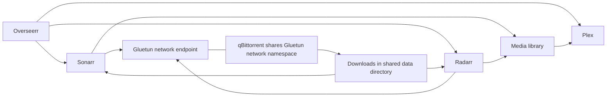

# Networks and combining services

A stack is a Compose project: services, their storage and their networks managed together. One project can contain several related applications. Separate projects can also communicate through a deliberately shared network.

The individual definitions in this collection use portable networking defaults. They do not reproduce the private network layout of my server, which has separate service and platform networks. Importing one does not attach it to every existing service automatically.

## Internal ports and host ports are different

```yaml
ports:
  - "127.0.0.1:18080:8080"
```

The browser on the Docker host uses `http://127.0.0.1:18080`. A container sharing a network with the service uses `http://service-name:8080`. It uses the **container port**, not `18080`. Inside a normal container, `localhost` means that container, not the server or another application.

Compose normally creates a project bridge network and provides DNS by service name. Do not hard-code container IPs; they can change during recreation. Two projects both declaring a network called `media` normally get different project-scoped networks. Cross-project sharing requires an explicitly shared external network.

## Option A: one project for related services

A media project can contain Plex, Overseerr, Sonarr, Radarr, Gluetun and qBittorrent. That gives it one lifecycle (`up`, `ps`, `down`) and an explicitly selected network. It does not automatically connect their application APIs or set library paths.

The [combined media example](examples/media-stack/README.md) supplies a complete optional definition, environment example, setup instructions and the exact internal addresses to enter. It is separate from the individual service definitions; use one deployment layout, not duplicate copies of the same apps against the same state.



Only qBittorrent shares Gluetun's VPN network namespace. Putting every media application behind the VPN usually creates unnecessary routing/access complications. The project bridge still permits normal outbound internet access; a project network is not an outbound firewall, and it is not marked `internal: true` because these apps need external APIs/indexers.

## Option B: separate projects, one intentional shared network

Use this when you want independent deployment/update lifecycles but selected applications need to talk. On a new intended host, create the shared network once:

```sh
docker network create media-shared
```

In each participating project's Compose file:

```yaml
services:
  sonarr:  # attach your actual service; retain its other configuration
    networks:
      - media
networks:
  media:
    external: true
    name: media-shared
```

Use unique service names or network aliases on a shared network. Two different services both called `db` can produce ambiguous DNS. An external network must already exist, and Compose does not remove it with the project. Creating it does not attach existing containers; apply membership through the tool that owns each stack.

## Keep databases away from the shared proxy network

A frontend can join an application network and a proxy network while its database joins only the application network:

```yaml
services:
  app:
    networks: [app, proxy]
  db:
    networks: [app]
networks:
  app: {}
  proxy:
    external: true
    name: shared-proxy
```

This is a membership sketch to incorporate into real service definitions; it is not a deployable application. Add a private internal database network only if it fits that application's egress needs. Network membership is not an authentication system. The app still needs the correct database host, credentials and API settings.

For Traefik, the backend must share a reachable network with the proxy and use the correct internal service port. When a backend is on multiple networks, select the intended network in its proxy configuration; otherwise discovery may choose the wrong path. Use the actual platform-owned network name, not a guessed `coolify` network on another installation. [Coolify import notes](coolify/README.md) and [Traefik setup](traefik/README.md) explain this collection's examples.

## Host networking and VPN namespaces are special

- `network_mode: host` uses the host network directly. Compose bridge service-name discovery and `ports` mappings do not apply in the usual way. Check host port conflicts. Samba and some monitoring/browser definitions use this mode; read their notes before copying them into another project.
- `network_mode: service:gluetun` gives qBittorrent the gateway's network namespace. Put its published ports on Gluetun and configure Sonarr/Radarr to reach `gluetun` at the qBittorrent internal WebUI port. Do not add a separate `networks` block to qBittorrent in that layout.
- A health-based `depends_on` waits for initial gateway health, but it does not certify the VPN's behaviour forever. Verify the downloader's egress and the VPN firewall/failure behaviour before relying on it. A normal restart policy is not an outbound-leak test.

## Combining existing files needs a review

Copying selected service entries into one new Compose file is often easier to understand than layering unrelated stack files. Keep each app's own config directory, adopt consistent shared data paths, rename colliding services/volumes/variables and select networks explicitly. Services that used `network_mode: host` or shared a VPN namespace need deliberate treatment.

Compose also supports `-f base.yaml -f override.yaml`, but this **merges** definitions. Duplicate service names are combined, later values can override earlier ones and some lists are extended. Paths are interpreted relative to the first file. These independent templates reuse variables such as `WEB_PORT` and named-volume keys such as `volume_1`; blindly combining them can select the wrong port or storage. Do not simply concatenate their YAML documents or `.env` files.

Run `docker compose --env-file .env config --quiet` on the intended combined project, inspect storage and network memberships, then configure the application integrations. For an existing lab, plan any move as a separate migration: container names/project changes can select new volumes, and two instances must not write the same application state simultaneously.

## Official references

- [Docker: Compose networking and external networks](https://docs.docker.com/compose/how-tos/networking/)
- [Docker: merging Compose files and path rules](https://docs.docker.com/compose/how-tos/multiple-compose-files/merge/)
- [Docker: startup order and readiness](https://docs.docker.com/compose/how-tos/startup-order/)
